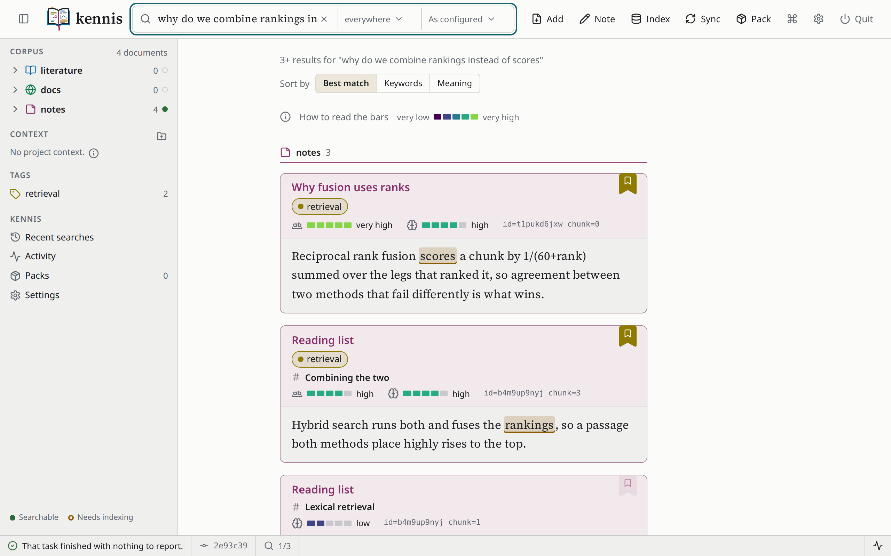

<!-- Absolute addresses: PyPI renders this file from the sdist, where a
relative image is broken. PyPI drops <picture> and keeps the . -->
<picture>
  <source media="(prefers-color-scheme: dark)" srcset="https://raw.githubusercontent.com/kwazzi-jack/kennis/main/docs/assets/brand/wordmark-dark.svg">
  
</picture>

# kennis

A local knowledge and memory system for people and AI agents.

You put papers, documentation sites and your own notes into one corpus on
your machine, and kennis searches it by the words you type and by what you
mean, then shows you the passage it found. The same corpus is open to you at
the terminal, in a window in your browser, and to an AI agent over MCP.



**Documentation: <https://kwazzi-jack.github.io/kennis/>**

## Status

**kennis is experimental.** It is pre-release software written by one person
for their own research. Its commands, settings and on-disk format change
between releases without notice or migration, so a corpus built now is one
you should be prepared to rebuild. Expect bugs.

**Linux is the platform kennis is developed and used on.** macOS runs the
test suite in CI. **Windows is not yet working properly**: CI runs the tests
there, but kennis is not used on Windows, and Windows users should expect
far more bugs than on Linux. Running kennis under WSL has not been tried.

## Install

You need Python 3.12 to 3.14, [uv](https://docs.astral.sh/uv/) and `git`.

```
uv tool install kennis                # the command line, the window and PDF conversion
uv tool install "kennis[mcp]"         # and the MCP server for agents
```

PDF conversion is the large part of the install: MinerU brings PyTorch, and
on Linux the CUDA libraries, several gigabytes. The
[install guide](https://kwazzi-jack.github.io/kennis/getting-started/install/)
says how to take PyTorch's CPU build instead, which is a few hundred
megabytes.

## A first corpus

Create the corpus, which is a folder of markdown files and a git repository
at `~/.local/share/kennis`:

```
kennis config init --defaults
kennis corpus init
```

Put something in. `remember` writes a note; `corpus add` brings in a file
(`-n` notes), a paper by arXiv identifier or DOI (`-l` literature) or a
documentation site (`-d` docs):

```
kennis remember "Reciprocal rank fusion scores a chunk by 1/(60+rank) summed over the legs that ranked it, so agreement between two methods that fail differently is what wins." --title "Why fusion uses ranks"
kennis corpus add -n reading-list.md --title "Reading list"
kennis corpus add -l arxiv:1101.1764
kennis corpus add -d https://docs.astropy.org/en/stable/ --max-pages 20
```

Index it, then search. The first index downloads a 65 MB embedding model,
once:

```
kennis corpus index
kennis search "why do we combine rankings instead of scores"
```

```
Found 3 in notes

Notes keywords as a fraction of the best match here, meaning as an absolute cosine
  [1] Why fusion uses ranks
      keywords: very high  meaning: high  id=t1pukd6jxw chunk=0
      kennis://open/t1pukd6jxw/0
      # Why fusion uses ranks Reciprocal rank fusion scores a chunk by
      1/(60+rank) summed over the legs that ranked it, so agreement
      between two methods that fail differently is what wins.
  [2] Reading list - Combining the two
      keywords: high  meaning: high  id=b4m9up9nyj chunk=3
      kennis://open/b4m9up9nyj/3
      ## Combining the two Hybrid search runs both and fuses the rankings,
      so a passage both methods place highly rises to the top.
  ...
```

Each hit gives two measures. `keywords` is BM25, the words you typed, as a
fraction of the best match in that collection; `meaning` is the cosine
similarity of the embeddings, on a scale measured for this model, so it
means the same thing for every query. The line above the group names both
scales. `id` and `chunk` are what `kennis read` takes, and the
`kennis://` link opens the passage in the window.

```
kennis read t1pukd6jxw                # the whole document, as markdown
kennis read b4m9up9nyj --chunks 3     # just the passage that matched
kennis tag retrieval kennis://open/t1pukd6jxw/0
kennis search "how are results combined" --tag retrieval
```

The [tutorial](https://kwazzi-jack.github.io/kennis/getting-started/tutorial/)
runs these steps with their full output.

## The window

```
kennis gui
```

opens kennis in your own browser: the same search, each passage drawn in
place, the corpus as a tree, tags, and adding and indexing with their
progress shown. It is served on `127.0.0.1` by kennis's own service, and
every request carries a token minted when the service starts. The picture at
the top of this page is the window. See
[The graphical interface](https://kwazzi-jack.github.io/kennis/how-to/the-interface/).

## An agent

With the `mcp` extra installed, an agent that speaks MCP starts
`kennis serve` itself. For Claude Code, in `~/.claude.json`:

```json
{
  "mcpServers": {
    "kennis": { "command": "kennis", "args": ["serve"] }
  }
}
```

The agent can then search and read the corpus, cite a passage with a link
that opens it in your window, and write a note with `remember` - the one
tool that changes anything. See
[Serve an agent](https://kwazzi-jack.github.io/kennis/how-to/serve-an-agent/).

## Learn more

- [Add documents](https://kwazzi-jack.github.io/kennis/how-to/add-documents/)
  and [a documentation site](https://kwazzi-jack.github.io/kennis/how-to/add-a-documentation-site/)
- [Search and read](https://kwazzi-jack.github.io/kennis/how-to/search-and-read/)
- [Project knowledge](https://kwazzi-jack.github.io/kennis/how-to/project-context/):
  a `.context/` folder committed with a project and searched beside the corpus
- [Author a pack](https://kwazzi-jack.github.io/kennis/how-to/author-a-pack/):
  a file that declares papers, sites and notes for kennis to fetch
- [How retrieval works](https://kwazzi-jack.github.io/kennis/explanation/retrieval/):
  what the two measures mean and how hits are ranked
- [Commands](https://kwazzi-jack.github.io/kennis/reference/cli/), generated
  from the code

## Your data

kennis keeps everything on your machine, has no telemetry, and sends a
document to a third party only when you set a hosted backend and supply its
key. Adding a paper or a site fetches from the host you name, and an agent
connected through `kennis serve` passes what it reads to whatever its model
runs on. The full list, with every host, is
[Your data: where it is kept and where it goes](https://kwazzi-jack.github.io/kennis/privacy/).

## Contributing

See [CONTRIBUTING.md](https://github.com/kwazzi-jack/kennis/blob/main/CONTRIBUTING.md).
To run kennis from a checkout:

```
git clone https://github.com/kwazzi-jack/kennis.git
cd kennis
uv sync --extra mcp
uv run kennis --help
```

## Licence

GPL-3.0-or-later. See `LICENSE`.
