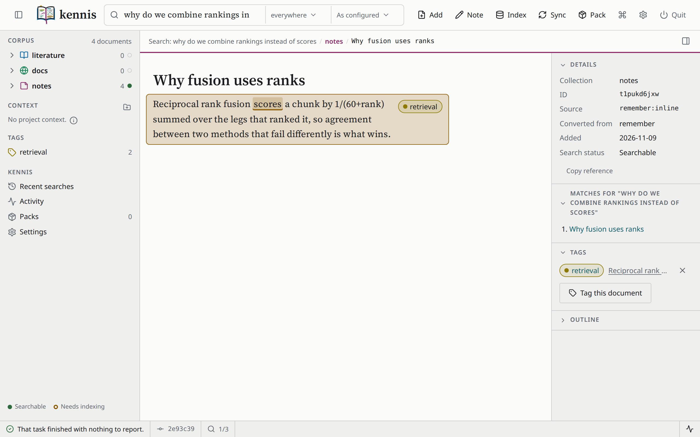

# Tutorial: your first corpus

Fifteen minutes, from nothing to a corpus you can search by words and by
meaning, read, tag, open in a window and hand to an agent. Every command and
every output below was run; only the paths are shown at their default
location rather than the throwaway one used to produce them, and your
document identifiers will differ, because each is minted when its document
is created.

You will need kennis [installed](install.md). Nothing else - this tutorial
uses no PDFs and no API keys.

## 1. Set kennis up

```
kennis config init
```

The wizard asks only what depends on you, and every question offers what is
already in effect, so pressing return throughout is a valid run. Accept the
defaults: `fastembed` for embedding, which runs locally and needs no key.
Every setting is then written to the file, including those you left at their
default.

To skip the questions and take every default:

```
kennis config init --defaults
```

```
Wrote every setting at its default to ~/.config/kennis/config.toml
```

## 2. Create the corpus

```
kennis corpus init
```

```
Created corpus at ~/.local/share/kennis
```

That folder holds three collections - `literature`, `docs` and `notes` - and
is a git repository. Every change from here is a commit.

## 3. Write three notes

`kennis remember` writes a note into the `notes` collection.

```
kennis remember "Reciprocal rank fusion scores a chunk by 1/(60+rank) summed \
over the legs that ranked it, so agreement between two methods that fail \
differently is what wins." --title "Why fusion uses ranks"
```

```
Remembered Why fusion uses ranks, not indexed in 21ms
  + notes/Why fusion uses ranks.md
  hint: run `kennis corpus index` to make it searchable
```

Two things to notice.

The note is a real file with the name you gave it, in a folder you can open
in any editor. kennis stores markdown, not a database.

And it says **not indexed**. Writing a document and making it searchable are
separate steps, and kennis tells you which has happened. Once an index
exists, `remember` updates it in the same command; the first note has no
index to update yet.

Add two more:

```
kennis remember "A cosine similarity has an absolute meaning only for the \
model that produced it. Cuts measured for one embedding model say nothing \
about another." --title "Relevance bands are per-model"

kennis remember "The corpus is ordinary markdown in ordinary directories. A \
directory holding content.md is a document with assets; any other directory \
is a group." --title "Corpus layout"
```

## 4. Add a file

Save this as `reading-list.md`:

```markdown
# Reading list for the retrieval chapter

## Lexical retrieval

BM25 ranks a passage by how often the query's words appear in it, weighted
by how rare each word is across the collection, and normalised for the
passage's length. It finds exact terms and names reliably and knows nothing
of synonyms.

## Dense retrieval

An embedding model maps a passage and a question to vectors, and the
nearest vectors by cosine similarity are the answer. It finds paraphrases,
and can miss an exact identifier that a keyword search would catch.

## Combining the two

Hybrid search runs both and fuses the rankings, so a passage both methods
place highly rises to the top.
```

and add it to the notes:

```
kennis corpus add -n reading-list.md --title "Reading list"
```

```
Added 1 document in 4ms
  + Reading list
```

`corpus add` takes the collection as `-n` (notes), `-l` (literature) or `-d`
(docs). A paper or a documentation site is added the same way; see
[Add documents](../how-to/add-documents.md).

## 5. Index

```
kennis corpus index
```

```
Using fastembed BAAI/bge-small-en-v1.5
Indexed 4 documents as 7 chunks in notes in 291ms
```

A *chunk* is the unit kennis searches: a passage of a document, cut at its
headings and paragraphs. The reading list is four chunks, one per heading.

The first time you run this, kennis downloads the embedding model - about
65 MB - and prints a line saying so before it starts. It is cached in
`~/.cache/kennis/models`, so this happens once and survives a reboot.

## 6. Search

```
kennis search "why do we combine rankings instead of scores"
```

```
Found 3 in notes

Notes keywords as a fraction of the best match here, meaning as an absolute cosine
  [1] Why fusion uses ranks
      keywords: very high  meaning: high  id=t1pukd6jxw chunk=0
      kennis://open/t1pukd6jxw/0
      # Why fusion uses ranks Reciprocal rank fusion scores a chunk by
      1/(60+rank) summed over the legs that ranked it, so agreement
      between two methods that fail differently is what wins.
  [2] Reading list - Combining the two
      keywords: high  meaning: high  id=b4m9up9nyj chunk=3
      kennis://open/b4m9up9nyj/3
      ## Combining the two Hybrid search runs both and fuses the rankings,
      so a passage both methods place highly rises to the top.
  [3] Reading list - Lexical retrieval
      meaning: low  id=b4m9up9nyj chunk=1
      kennis://open/b4m9up9nyj/1
      ## Lexical retrieval BM25 ranks a passage by how often the query's
      words appear in it, weighted by how rare each word is across the
      collection, and normalised for the passage's length. It finds exact
      terms and names reliably and knows ...

  hint: run `kennis read t1pukd6jxw --chunks 0:2` to read one in context
```

Every search runs two methods, called *legs*, and fuses their rankings:

- **`keywords`** is BM25, which scores the words you typed. Its level is a
  fraction of the best keyword match in this collection, so the top keyword
  hit is `very high` by construction. The third hit has no `keywords` level,
  because it shares no word with the query.
- **`meaning`** is the cosine similarity between the embedding of your query
  and that of the passage. Its level is on cuts measured for this specific
  model, so `high` means the same thing for every query.

The line above the group names both scales, because the two are different
measurements. **`id=` and `chunk=`** say where the passage is, and the
`kennis://` link opens it in the window (step 9).

### Where meaning finds what keywords cannot

Ask for something that the reading list describes in other words. With the
meaning leg switched off:

```
kennis search "blending the outputs of several retrievers" --mode bm25
```

```
Searched notes
warning: no matching passages
```

No passage contains "blending", "outputs" or "retrievers". With both legs,
as by default:

```
kennis search "blending the outputs of several retrievers"
```

```
Found 3 in notes

Notes meaning as an absolute cosine
  [1] Reading list - Dense retrieval
      meaning: medium  id=b4m9up9nyj chunk=2
      kennis://open/b4m9up9nyj/2
      ## Dense retrieval An embedding model maps a passage and a question
      to vectors, and the nearest vectors by cosine similarity are the
      answer. It finds paraphrases, and can miss an exact identifier that
      a keyword search would catch.
  [2] Reading list - Reading list for the retrieval chapter
      meaning: low  id=b4m9up9nyj chunk=0
      ...
  [3] Reading list - Combining the two
      meaning: low  id=b4m9up9nyj chunk=3
      ...
```

The meaning leg found passages about retrieval. Its best is only `medium`,
and kennis says so rather than flattering the best result it happened to
find. [How retrieval works](../explanation/retrieval.md) says how the levels
are measured.

## 7. Read

```
kennis read t1pukd6jxw
```

```
Read [notes] Why fusion uses ranks  (t1pukd6jxw)  notes/Why fusion uses ranks.md
# Why fusion uses ranks

Reciprocal rank fusion scores a chunk by 1/(60+rank) summed over the legs that ranked it, so agreement between two methods that fail differently is what wins.
```

The `Read ...` line, which says what was read, goes to **standard error**;
the document goes to **standard output**. So this gives you the markdown and
nothing else:

```
kennis read t1pukd6jxw > note.md
```

For a long document, read just the passage a hit pointed at:

```
kennis read b4m9up9nyj --chunks 3
```

```
Read [notes] Reading list  (b4m9up9nyj)  notes/Reading list.md  (chunk 3)
## Combining the two

Hybrid search runs both and fuses the rankings, so a passage both methods
place highly rises to the top.
```

## 8. Tag what you want to find again

A tag is a name you put on a document or on one passage of it. Give a
passage by the `kennis://` link its hit printed:

```
kennis tag retrieval kennis://open/t1pukd6jxw/0 kennis://open/b4m9up9nyj/3
```

```
Tagged Why fusion uses ranks: retrieval
  + kennis://open/t1pukd6jxw/0
Tagged Reading list: retrieval
  + kennis://open/b4m9up9nyj/3
```

A search can then be kept to what a tag holds:

```
kennis search "how are results combined" --tag retrieval --snippet none
```

```
Found 2 in notes

Notes meaning as an absolute cosine
  [1] Reading list - Combining the two
      meaning: medium  id=b4m9up9nyj chunk=3
      kennis://open/b4m9up9nyj/3
  [2] Why fusion uses ranks
      meaning: medium  id=t1pukd6jxw chunk=0
      kennis://open/t1pukd6jxw/0
```

`kennis tags` lists every tag and how many places carry it. See
[Tag passages and documents](../how-to/tag-passages.md).

## 9. Open the window

```
kennis gui
```

```
Serving the kennis window
  + http://127.0.0.1:35097/?token=...
```

This starts kennis's service if it is not running and opens the address in
your browser. The address is on `127.0.0.1`, so only this machine can reach
it, and the token is minted when the service starts. Type the step 6 query
into the search box and the window shows the same hits as the terminal did,
with the two measures as bars and each passage drawn as formatted text. The
picture on the [home page](../index.md) is that search. A hit's title opens
its document, with the passage that matched marked and its tag beside it:



`kennis open kennis://open/t1pukd6jxw/0` opens a passage from the terminal
the same way. **Quit** in the window's bar stops the service; closing the tab
does not. With no window open and no task running, the service stops by
itself after 30 minutes. See
[The graphical interface](../how-to/the-interface.md).

## 10. Hand it to an agent

This step needs the `mcp` extra: `uv tool install "kennis[mcp]"`. An agent
that speaks MCP starts `kennis serve` itself. For Claude Code, add this to
`~/.claude.json`:

```json
{
  "mcpServers": {
    "kennis": { "command": "kennis", "args": ["serve"] }
  }
}
```

In a new session, ask it *"What do my notes say about combining rankings?"*.
The agent searches with `search`, reads with `read`, and cites
the passage with `cite`, whose link opens it in your window. `remember` is
the one tool that writes, and the agent is told to use it only for what you
ask it to keep. See [Serve an agent](../how-to/serve-an-agent.md).

## 11. Look at what you built

```
kennis corpus tree
```

```
Literature
Docs
Notes
  fhx9elbc0j  Corpus layout.md
  b4m9up9nyj  Reading list.md
  7fr30shh9q  Relevance bands are per-model.md
  t1pukd6jxw  Why fusion uses ranks.md
```

```
kennis corpus history
```

```
  2e93c398  2026-11-09 17:07  tag(corpus): 2 tagged
  43f36ca9  2026-11-09 17:06  index(corpus): 4 documents, 7 chunks
  196464de  2026-11-09 17:06  add(notes): 1 added
  ...
  6765067e  2026-11-09 17:06  init(corpus): create the corpus
```

Every step committed, so nothing you have done is unrecoverable. See
[Inspect and recover](../how-to/history.md).

## Where to go next

- [Add documents](../how-to/add-documents.md) - papers, PDFs, and
  [whole documentation sites](../how-to/add-a-documentation-site.md)
- [Project knowledge](../how-to/project-context.md) - a `.context/` folder
  committed with one project and searched beside the corpus
- [How retrieval works](../explanation/retrieval.md) - what the two measures
  actually mean
- [Commands](../reference/cli.md) - every option
