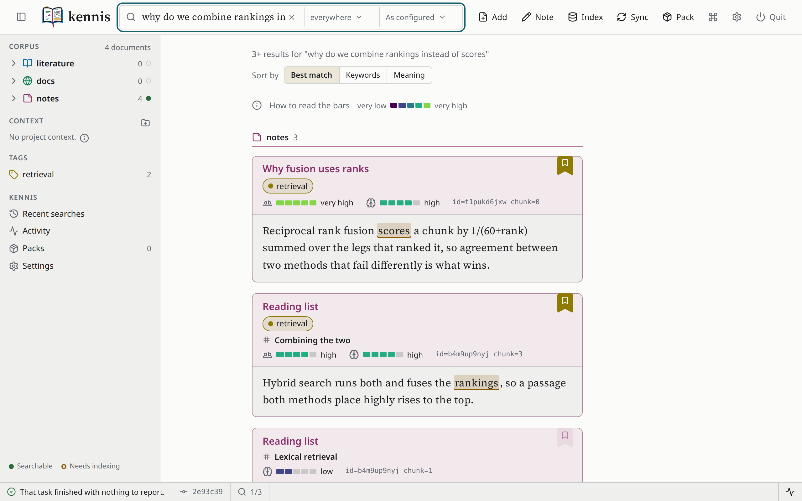

# { width="320" } { width="320" }

A knowledge and memory system for people and AI agents: a document corpus you
own, and retrieval over it that searches by meaning as well as by words.

You put papers, documentation sites and your own notes into one corpus on
your machine. kennis indexes them, finds the passage that answers a
question, and shows it to you at the terminal, in a window in your browser,
or to an AI agent over MCP. kennis is **domain-agnostic**: it knows nothing
about any particular subject until you give it documents.



## How you use it

1. **Put documents in.** `kennis corpus add` takes a PDF, a paper by arXiv
   identifier or DOI, a whole documentation site, or a markdown file;
   `kennis remember` writes a note. Each lands in one of three collections -
   `literature`, `docs` or `notes` - as an ordinary markdown file in a git
   repository, which you can read and edit without kennis.
2. **Index them.** `kennis corpus index` builds two indexes per collection:
   BM25 for the words, and dense embeddings for the meaning.
3. **Search, and read what was found.** A search reports each hit with a
   `keywords` and a `meaning` measure and a link to the passage; `kennis
   read` prints the document or the passage alone.
4. **Keep what matters.** Tag a passage, cite it, or write a note about it,
   and it comes back in later searches.

```
kennis corpus add -l arxiv:1101.1764
kennis corpus index
kennis search "why does rank fusion beat score fusion"
kennis read yusk5agyfk --chunks 2:5
```

The same corpus is reached three ways:

| from | command | for |
|---|---|---|
| a terminal | `kennis search`, `kennis read`, ... | scripts, and output you can redirect |
| a browser | `kennis gui` | reading passages in place, browsing the tree, tagging |
| an agent | `kennis serve`, started by the agent | an assistant that searches and cites your corpus |

## What makes it different

**Your documents stay yours.** Conversion runs locally by default and
embedding runs locally by default. Sending a document to a third party
requires setting a backend *and* supplying a key - never one without the
other, and never as a default. [Where your data goes](privacy.md) lists
every way anything leaves the machine.

**The relevance level is measured, not invented.** When kennis says a hit's
meaning is `high`, that is a cosine similarity against cuts measured on a
real corpus for that specific model. When it cannot make an absolute claim
it says so above the results, and when it has no scale at all it shows no
level rather than inventing one.

**A handle never breaks.** A document's identifier is fixed when the
document is created, so you can retitle, regroup, or move a document
between collections and everything that referred to it still resolves.

**The output is a payload.** `kennis read x > x.md` gives you the document
byte for byte. Colour is dropped when stdout is not a terminal, and no line
is padded or re-wrapped.

## Where to start

<div class="grid cards" markdown>

- **New here?**
  [Install](getting-started/install.md), then the
  [tutorial](getting-started/tutorial.md) - fifteen minutes, no PDFs, no keys.

- **Want to do one thing?**
  The [how-to guides](how-to/add-documents.md) are task-shaped.

- **Want to know why?**
  [How retrieval works](explanation/retrieval.md) is the one to read.

- **Looking up an option?**
  [Commands](reference/cli.md), generated from the code.

- **Not at a terminal?**
  [The graphical interface](how-to/the-interface.md) does the same work in
  a window.

- **Wiring up an agent?**
  [Serve an agent](how-to/serve-an-agent.md) - MCP over stdio, six tools.

</div>

## Status

**kennis is experimental.** It is pre-release software, and its commands,
settings and on-disk format change between releases without migration. It
keeps no backwards-compatibility shims: when something is reworked, the old
path is removed rather than deprecated. Linux is the platform it is
developed and used on; macOS runs the test suite; Windows is not yet working
properly.

Built and usable: the corpus, search, the command line, tags and citations,
the per-project context, packs, the [MCP server](how-to/serve-an-agent.md)
and the [graphical interface](how-to/the-interface.md). Not built:
cross-machine synchronisation, and any packaged application.
